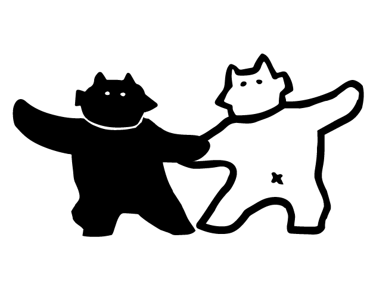

> **摘要**:
> 本文是李盆《羊呆住了》一书的序言，作者以业余写作者身份探讨写作出路。他认为次级知识（由人衍生、远离对象本身的知识）多为生产工具、社交工具和消费消费品，应回到“祛魅之后的日常事物”去阅读世界底部。他称全民书写让汉语生命力空前爆发，但输入法使高频词集中，词语因过度使用产生“所指增生”，人们对热词过敏，最终词语死亡。他将自媒体与书视为“假乌托邦”，指出今日头条式“塑料新闻”是数字生意，出版本质是生意、媚众、不挑战公众经验。他主张文学应寻找分歧、差异与超现实，反对刻奇的共同质地，反对象征和隐喻的矫饰；主张破除文体分类、反对“文以载道”的工具论、不抱目的去写，认为业余比专业更有价值，并应重估文学史。最后强调写作只需母语和头上“一小块寂静”，是对自我存在的自证。
> 
> **要点总结**:
> 1. 次级知识多是生产工具、社交工具和情绪消费品，应回到祛魅之后的日常事物去阅读，日常事物是一切知识的源头。
> 2. 输入法让高频词越来越高频，词语过度使用后发生“所指增生”，背负过多额外意指，导致人们对过期热词过敏并最终使词语死亡。
> 3. 自媒体和书是“假乌托邦”：今日头条等“塑料新闻”客户端本质是数字生意而非媒体；出版本质是生意，媚众、绝不挑战公众经验，甚至“看起来是好书的烂书”最危险。
> 4. 文学应摆脱对共同质地和刻奇的追求，去寻找分歧、差异与弥散；非虚构是更省力、更具实验性的素材采集方式，类似杜尚的“现成品”。
> 5. 反对象征和隐喻的矫饰编码，但肯定万物原始的相似性；主张破除文体分类、反对“文以载道”的工具论、不抱目的去写。
> 6. 业余比专业更有价值，写作只需母语和一小块寂静，是自证存在和提供自由幻觉的方式，不应为名利或目的而写。
> 7. 文学史分类和流派建立在误读之上，应按动机（无聊、钱、虚荣、求真等）重新分类；“伟大往往就是失真”。
> 
> **客观性检查**: 文章是明确的个人宣言而非客观报道，带有强烈主观倾向和情绪化断言，如称今日头条“唯独没有像样的观念和意识”“其实就是一个非常忙碌的煤矿”，以及“骂咪蒙的人几乎都以为自己是出于良心，但其实是嫉妒心和仇富心理在起作用”，属以偏概全和诛心之论；整体呈现鲜明的单方立场与说服意图。

---

## 业余作者如何摸索出路

约小亚

**编者注：本文为李盆《羊呆住了》一书的序言部分。原文整理于 2017 年 4 月，经作者本人授权转发。**

我是最近两年才意识到我们这代人的幸运之处。

一个普通的下午，即便你站在公交车站旁边，也能看到世界上的熵在急剧增长，有史以来最大的「现象」浪潮正在远远地过来。

世界上事情最多的时候，理应是一个地球人感到好奇和兴奋的时候。

一切都正在解体、流动和闪烁。知识和历史被纷纷打碎，但还不够碎，我正想是不是应该再踩上一脚。

以下所说的有部分观点来自之前的知乎 live，这些看法无论优劣，都是我在写的那一刻内心真正相信的。

目的不在于求认同，而是提供不一样的个人见解。

## 去世界底部，阅读日常事物

知识是一把双刃剑，要不要持续地寻求知识是一个永恒的矛盾。但我们至少可以说服自己去怀疑一些次级知识。

在自然科学之外，其他次级知识的发展，容易坠入一种纯粹的智力游戏，最终远离知识对象，让知识本身变成了对象。也可能只是沦为一场复杂的语言实践，除了语言之外，什么都不相干。变成语言与语言之间、逻辑与逻辑之间的耳光，然后又把这种互搏游戏作为对象，加以评论与解释，再以评论评论评论，以解释解释解释。

许许多多新奇的书，惊世骇俗的显学，带「后」字的新思潮就这样层出不穷。

而我们也只是把次级知识当做生产工具、社交工具和消费品。

当你写出一个鹅卵石的论文，并不是因为鹅卵石里面有什么论文，只是因为你需要一个论文。

所有的次级知识都是来自于人自己，而不是对象本身。这时候知识不是为了求真，而是和犁一样成为生产工具。一篇论文的文本，是潜在的商品与通行证，意味着名声、学位、职业前途等等。但鹅卵石始终是沉默的。

次级知识在它的市场中，更多的是一种社交式阅读和情绪消费品。在单向街或者雕刻时光里面，慢慢变得只有道具式的新书和阅读周边。阅读已经普遍生活方式化的时候，读者潜意识中关注的是，这种知识在社群中能为自己带来什么，关注度、钱、名声、一种生活方式的满足、疲惫生活的代偿、抵消虚度时间带来的内疚、辩论中的优势、智力虚荣的满足、输出欲与倾诉欲、比较与考据的游戏感等等。

但终究，次级知识只是展示一些不多于自己的东西。甚至什么都没有，只有一些「真理式的激情」。

所以应该去底部阅读日常事物，重新看待身边的一切。世界的底部并不在远处，不在亚马逊雨林或者撒哈拉腹地，也不在五十一区或者教堂里面，更不在任何卷宗之中。

人类没有什么彼岸，只有一些日常事物，世界的底部就是祛魅之后的日常事物，沉默地存在于次级知识的泡沫深处。

走在下班的路上，身边琐碎的一切，上面都笼罩着一层透明的符号，衍生知识，行为痕迹，还有问号与待填补的空白。日常事物就是一切知识的源头、标本和实践场合。

人们应该永远尊重的一个人是弗洛伊德。无论有多少人说他的理论已经边缘化，那也只是知识权力和知识中心例行转移的结果。

弗洛伊德不是书斋式的理论家，他是整个知识历史中罕见的元作者，直面并且克服生而为人的本来缺陷，几乎不依靠任何知识和结论，仅仅凭借对日常事物的观察便完成了属于自己的理论。而他最重要的日常事物标本就是自己。弗洛伊德完美地证明了，至少在社会科学和文学领域，最好的阅读和思考，都是没有屋顶的。

另外一位善于观察和思考的地球爱好者列维-斯特劳斯，是这样说他如何在岩画中感受到结构主义要义的：

> 当你忽然发现……可以同时在岩石上面发现两个菊石的遗痕，……两个化石之间存在着长达几万年的时间距离，在这时候，时间和空间合而为一：此刻仍然存活着的多样性与不同的年代相重叠，并且加以保存延续。思想和情感进入一种新的层次，在那当中，每一滴汗，每一片肌肉的移动，每一息呼吸，全都成为过去的历史的象征，其发展的历史在我身体重现，而在同时，我的思想又拥抱其中的意义。

列维-斯特劳斯提到的是结构主义的主要观念之一——重共时性而轻历时性。这种主张不仅仅是在岩画之中，其实在日常生活中的任意一个角落都能发现，一切历史都被拍扁在此时此刻，并与当下的事物共生，互为参照互证异同。

按照日常事物的眼光来看，即便是被全社会猛烈抨击的教育体系，其实也并不是一无是处。基础教育中有许多值得赞赏的做法，比高等教育更好。当在网上随手查询「日常事物」的时候，会发现这样的在线作业题：

> 作文！任选一个日常事物，认真观察、体会写出它带给你的启示。（不少于300字）（2014-10-07）
> 
> 任选一个日常事物,认真观察,体会写出它带来的启示。500字作文。（2014-11-19）
> 
> 仿照《蝉》《贝壳》课文的写法，任选一个日常事物，认真观察体会，写出它带给你的启示。（2014-12-15）
> 
> 一篇从平常事物中发现生命的意义的初中生作文。要求：认真观察、体会，写出它带给你的启示。（2014-10-07）
> 
> 写一件平凡的事物作文（最好是路灯……要带有启示的。（2014-09-23）

这是我们每个人都写过的、熟悉的作文模式。它们其实并不像看起来那么弱智，本身可以看成是胡塞尔或者列维斯特劳斯式的命题，没有什么表明不可以在小学生的意识中切开一条接受现象学和人类学的缝隙，并且，小学生学游泳的速度远比成年人更快。遗憾的是，没有什么体系内的老师可以真正挖掘这种做法，因为老师也普遍是次级知识和高等应用型教育的产物。

所谓天赋其实个体差异不大，只是自觉意识不同而已，而教育决定了这种自觉意识。

偶然看到一段题外的话：

> 不仅在「自然界」，而且在整个世界中，经验都不占有真正重要的地位。因而，宇宙间的目的、价值、理想和可能性都不重要，也没有什么自由、创造性、暂时性或神性。不存在规范甚至真理，一切最终都是毫无意义的。

所以必须要在地上扶起日常事物，也许只有关注日常事物才可以让自己正视这个可能的结果，并为自己的一生寻找一个自洽的状态。

## 对词语过敏的自我诊断

在大家都喊着碎片阅读不行、汉语被用坏了的时候，实际上在 2016 年随便哪一天，人们写字的总频次，都几乎超过整个唐代。（猜的）

我很好奇，在所有应用中文的群体中，每 24 个小时会打出多少个汉字，这是一件很难统计的事情。如果不去计较竹纸绢帛和像素的区别，实际上没有任何一个年代出现过如此巨量的文字痕迹，人们从来没有这么密集而自然地书写过，而且是全民书写。即时通讯和自媒体实际上让汉语的生命力出现了空前的大爆炸。这不是语言集权化和精英化的年代，但从语言生命力的角度来看，是一个从没有过的黄金年代。

全民书写主要是汉字输入法的贡献。输入法书写是心理活动、口头表达和文字表达的中间形态，说和写进一步模糊，书面和口语之间不再分明。这种简便和快捷带来的渗透程度，让输入法在文字应用上的贡献几乎可以超过活字印刷。

但输入法中的语义联想和热词推荐，代表了这类工具的一个主要毛病，即高频词越来越高频，活跃汉字越来越集中。一味讨好用户是互联网产品的原罪，输入法也不可能躲掉这个原罪。

当一亿个人都使用同一种输入法打出「卧槽」的时候，「卧槽」就会被优先并且持续地打出来。卧槽本来是一个非常陌生而且无辜的词，甚至可以说是一个不存在的词，但如今陷入了一种虽不重要但也不必要的思虑和麻烦。

在当下的语境中，显然是有这样一种细微的考量：使用「卧槽」是对脏话的一种有限回避，是一种给脏话加上滤镜的做法。由此发展出来的，还有游戏感更强的「握草」和「我屮艸芔茻」，而在评论区有些睾酮更高的青年，则更加直接地使用「我操」。

「卧槽」「握草」「我操」「我艹」「我擦」「我嚓」「我去」「我勒个去」「擦」「我屮艸芔茻」，这些词之间的细微差异，和如何在打字的瞬间被选择，关系到人们如何判定自我，以及如何考虑他人的反应。每一个使用中的瞬间选择，都是人们给自己贴上的一个细小的标签。标签并不起眼，但不可忽视。

最终这个词将被几亿人过度使用并且包浆，之后会永远背负着很重的意指负担，成为当时语境中的一个重要标本。

这是每个词汇在过度使用之后都不可避免要面临的命运：所指增生。

这种所指增生，让每个词都像是蝜蝂，在身上背负了太多的额外意指，一旦背上就不太可能卸得下来。

以至于几乎有这样一种假设：如果把全社会总的人文形态看成一件毛衣，然后把随意一个词语，比如「握草」，看成一个线头，揪住这个线头，便可以把整件毛衣拆干净。意指背后还有意指，意指是无限衍生的相似性，意指会吞食整个世界。

每个人都会对少量的词汇存在过敏反应。有一些过敏，就来自上述那些高度符号化和所指增生的肥胖词汇。

如果对两个曾经的网络热词进行尸检就会发现，「浮云」「洪荒之力」的猝死，都是所指增生的结果。

几年之前，「浮云」这个词在刚刚开始爆发的时候，它背后最强烈的意指是「网感」「新」「时髦」，使用这个词的人完全不是出于语义需要，而是贪图这种额外的意指，这也许并不是虚荣心那么简单。而当在几个月之后，「浮云」的使用频次过高而失去了新鲜感，人们就开始在修辞的鄙视链上迅速分化，像一队行进的蚂蚁忽然溃散。当又过了几个月的时候，「浮云」已经在互联网上大规模消退，最终在各大企业年会、春晚、地方政府两会稍微上回光返照一下，便逐渐落灰了。直到几年之后，仍然普遍存在回避「浮云」这个词的情况。

相比「浮云」，在被一轮一轮的人造热词训练过之后，「洪荒之力」的生命周期更短，面对的阈值更高。如今使用浮云的频次已经降低到很低的程度，而洪荒之力则面临消失。

> 来自微博的一句话：
> 
> 「看到说洪荒之力果断关掉。」

这两个词先后背负了「新」「创意」「互联网」「十万加」「追热点」「跟风」「俗」「老套」「过时」等互为因果的几种包袱。通过两个词的衰退路线，也很清楚地能看到从 iOS 到千元安卓机、从航站楼到绿皮车、从写字楼到集体宿舍、从创业公司到事业单位的几种社会地貌。

这种词语所指的增生，带来的后果就是人们对过期热词的过敏，最终是这个词语的死亡，硕大油腻，扔在废纸堆里。

新浪微博的编辑团队是最能炮制这种人工热词的团队，每个有动静的热词，都是微博团队一手发掘并调集流量浇灌，他们在一代人中间用废了不少无辜的汉字。

还有一些过敏，来自莫名其妙的通感，往往找不到原因。

有人从小学开始，就从来不使用「心痛」这个词，而是一直使用同义词「心疼」。只是觉得「心痛」两个字有一种中年人写信的感觉，略微浮夸，还带着弱势和潦倒的味道，甚至能让他联想到他和他爸的隔阂。而这种不能接受一个词的感觉，近似于不喜欢一种颜色的感觉，可以无限发酵，却像纯净水的味道一样很难用语言表达清楚。

还有的人不喜欢「母亲」这个词，因为有一种腰粗和肥胖的感觉。也有人不喜欢「却」这种笔画较少的虚词带来的干燥感。甚至还有人会因为形状而不喜欢「万」字。这种过敏一般都会在很长很长的时间里，改变一个人的用词习惯，并形成很多很多暗角。人们会在潜意识中直接淘汰所有不喜欢的字和词，通过近义词或者修辞来进行代偿。

这种通感通常来自独家记忆，和私人经验密切相关，每个人各有不同。

审美偏好是另外一种类型的敏感，一般称为「特别爱用」。

著名体育评论员杨毅的微信公众号中，平均每周能看到三到四次「漫长」和「漫漫长河」这两个词，始终弥漫着一种大漠孤烟直长河落日圆、时光深处有风吹来、英雄迟暮长歌当哭的感觉，这看起来是一种对史诗情绪的偏好，意味着繁忙都市生活中的英雄梦想，就如同相声演员在吃饱之后「那一夜梦见百万雄师」。

另外，在一些领导人的所有场合的讲话之中，用「当前」开头的段落占到一半以上，「当前，国际局势复杂多变……」「当前，改革进入深水区……」「当前，全球气候处于……」秘书对「当前」的应用，类似于一种仪式性的口头手势，一种齐刷刷的排比徐徐展开，说话间仿佛夹带着杀伐决断以及洞若观火两个微微发亮的成语。

还有一些常见的偏好，比如在行文中以形容词作画。把代表局部真理的金句断行加粗，仿佛一切陈述就是为了抵达这一行字。为了一个巧妙的环形逻辑而特意修改主旨。过度迷恋大珠小珠落玉盘的语感，写不到一千字就开始喘。或者通过自动书写偶尔发现一个精巧而迷幻的西式文字装置，却不知道如何安放。

「吟安一个字，捻断数茎须」的修辞传统之下，许多许多的传世作品，实际上都是一种文玩产物，审美也许是好的，却只有一个盆景那么大的格局。人们太喜欢口吐莲花和字字珠玑，最后忘了真正要说什么。

无论是哪种过敏，都是来自文字使用者本身。而词语永远是无辜、透明和中性的。

对词语的偏见，让这种用于书写的工具反而影响了书写本身，让文字成为文学的最大束缚。在语言文字面前，没有人是自由的，只是这种不自由没有任何不适，代价太低而不被注意。这是一个痔疮一样普遍存在却不显著、也无法根除的问题。

文字本身不应该是阅读的终点，文字本身只是一个起点。文字也不应该是写作的终点，只是设置一个观察和想象的窗口，提示叙述走向或者提示一种意识状态。如果对词语脱敏，减少对修辞的执念，文辞上的钝感往往能成就更多，就像卡夫卡和刘慈欣。

## 自媒体与书是假乌托邦

「有史以来第一次，在这个时代里，成千上万训练有素的人耗尽自己的全部时间，只求能打入集体的公共头脑。目的是为了操纵、利用和控制，旨在煽起狂热而不是给人启示。」来自麦克卢汉。1961 年。

还有这一句：「一切媒介都要重塑它们所触及的一切生活形态。」

麦克卢汉在几十年前说的话，在今天看来就像启示录一样。在电视刚刚出现的年代，麦克卢汉以修拉的点彩画法来形容当时的电视，这种二维显像的低清晰度的电子设备，用三百万束电子从另一侧轰击屏幕，人们只能注意到其中的几千个点，然后调动一切感官介入，快速完形。除了几千个光点之外，电视什么都没有提供，一切让人身心震撼东西，都只是观众大脑中的耸动而已。

显像技术发生巨变之后，4K 电视机和各类高清屏幕早已不符合当时的「冷媒介」定义，但本质上，它们仍可以被看作「电子修拉」，并以更高的信息清晰度裹挟观众全身心介入。

法国广告人把「冒险、欢乐和梦想」看成是消费主义时代最容易传播的内容，媒介像是一种通过管道迅速生长的巨型菌类，带着这些果味曲奇一样的内容席卷而来，掠夺注意力甚至掠夺意志，让每一个人成为自我意识薄弱的宿主。当在各种无孔不入的媒介面前忘情投入的时候，人们很容易变成一个吃到糖果的巨婴。

这是一个难置褒贬的趋势，有人反对，比如一些新勒德分子 ；有人支持，比如「技术是无罪的」；更多的人在看电视，不关心这些事。只是当你凝视屏幕的时候，屏幕也报以凝视，并带着吞噬的视角。

自媒体这种近年来刚刚兴起的媒介形态，更加快捷，更加消费化，更加哗哗作响。

其中有一类代表是今日头条、一点资讯等「塑料新闻」客户端。这些应用的内容模式和商业模式都非常相似，快速易读，精准推送，有自媒体成分，借内容来收割流量、广告和大数据。然后把这种简单的、满足读者小屏阅读需求的模式，通过组织管理和包装，可以做到估值 30 亿美元，年流水朝着 100 亿发展。

然而，今日头条此类内容平台的链条上什么都有，唯独没有像样的观念和意识。这种快新闻媒体，其实并不是媒体，而是扮演成媒体的一桩数字生意。

这种数字生意养活了十几个上下游的行业，相关的所有员工都在靠这种平台吃饭。大家都以内容创意和模式创新为名，付出劳动，获取一些报酬。劳动性质有三种，一种是搬运，一种是维护，一种是销售。这种劳动和挖煤差不太多，其实今日头条本身就是一个非常忙碌的煤矿，只是以定制化的零售信息为主。

另一种媒介的近似形态，是出版物。

即便是好的书，也只是知识的有限模拟物；而那些不好的书，则是模拟物的模拟物。一些纸张和装帧过的实体，悄悄在人们意识中非常逼真地饰演了「知识」和「学习」。但书不是知识和学习，就像武器不是战争，书以及背后的出版行业，也只是知识商品化的方式之一。

谷歌在 2010 年用他们的算法大致推算过，在一系列常识性的限定条件下，世界上的出版物有 1.46 亿件。印刷品这种东西，已经成了地球上最强势的「类媒介」之一，而且带着天然的光环。

从来没有人说过看书是不对的。但是现在，「看书」这种天赋正义的事情，是时候要被打破一下了。

电视、互联网、书这种印刷品，它们本质上是一样的。大部分书不见得是传递知识，也照样可以让人放弃思考，或者挟持思考，而且它们侵占意识的方式更加隐秘，更加让人觉得合理。最令人担心的不是烂书，烂书非常容易分辨。最令人担心的是看起来是好书的烂书，以经典之名，让一个读者一辈子的思辨基础都寄生在它身上。如果一个人他所有的思考基础都来自典籍，是非常可怕的，还不如不看书。思考框架建立在一本书上，还不如建立在一片树叶子上面。

而出版社从开始的时候，就是一门生意，它独立于作者本人而存活，所以它的最高目的一定不是帮读者什么忙，而是通过传播来卖出更多份的拷贝。出版是广义上的媒介和广告，它把一个人的作品从无形变成有形，然后封存、复制、传播、运输。这个过程和卖灯泡类似，卖灯泡也是把一个人的发现或者发明从无形变成有形，然后封存、复制、传播、运输。

最终卖出更多的拷贝，才符合出版社的本质。如果修改或者导演作者的作品能卖出更多的拷贝，他们也会这么做，实际上业内普遍在这么做。

大部分的消费化的书和媒介，有一种共同性格：绝不挑战公众经验。

出版、媒介和广告传播，是三个近亲。它们在本质上都是媚众的，一旦偏离公众经验，就会导致常规意义上的失败。一切辛苦的经营，都是为了要准确地构筑在公众的既定态度和既定情感范围之内。

有一个看法是：广告是把自动化原理拓展到社会中的一种尝试。营销模型大都是自动化原理的变体，目标就是让消费者按照预定规律运行，去掉理性和自主意识。消费化的出版和媒介也都是如此。

而我们常说的横贯许多个领域的「创意」，就是变着花样的讨好。创意的目的，就是让目标消费群一直保持注意力，待在舒适区里，然后等候收割。

书、内容与媒介消费化的另一个后果，是作者与读者之间，互相慢慢丧失本意。

以咪蒙为例，她的所有文章，和新口味的小浣熊干脆面是一个性质。咪蒙的新的推文一出来，潜台词都特别像那句广告语：「小浣熊的干脆面又出了新口味。」

这件事情的本质是她又为受众量身定做了一个「情绪八股」，也是一个商品，可以带来声量、流量，搅动一下争论，扩大一下注意力。这个话题完全不代表咪蒙本人的价值观，也不是她对任何人的任何说教，只是一种经营的方式。可以想象在策划这样一篇文章之初，她就已经预见到了一些人的激烈赞同和另一些人的激烈反对。

然后咪蒙的一条有争议的文章，同时可以催生上百篇带着明确目的蹭流量的微信文章，标题基本都带有咪蒙两个字，这些也都是商品。就像一条鲨鱼身上通常会寄生着八到十种吃腐肉的小鱼。

而骂咪蒙的人几乎都以为自己是出于良心，但其实是嫉妒心和仇富心理在起作用。这种嫉妒心，往往会藏在对价值观的批评后面。消费咪蒙的人，也未必会视咪蒙为偶像和导师，只是潜意识中崇拜热度与人气。

人们在自媒体当中，并不认真讨论，只是要占据舞台。

书和媒体无底线地变成商品，根本原因是我们的文化偏技术，当下的社会又是逐利和消费主义至上的。所以这个时代，面对书和媒介的时候，需要比以往更加警惕。如果你走进书店或者打开手机，内心预设是：这一切都是伪装的和别有用心的，也毫不为过。

而对于文学类的写作者来说，少看书可能是好事，另外，写「10 万+」的文章或者培养粉丝群这种事情，永远都不值得去做。

## 在当代艺术和非虚构之中，寻找可能性

史上大部分的文学作品，都是在复述，有的是在复述幻想，有的是在复述过往的现实，把已有的和规律中的事物再铺陈一遍。

复述是在求同，让人类摸一摸自己的共同质地。

能让人类大规模自我触动的作品，多数是谋求一种刻奇。个人回忆会变成集体回忆，个人情感会变成集体情感。感动数十亿人，在灯光亮起的时候纷纷起立鼓掌，或者成为永恒的警句刻在所有的墙上。大都如此。

已经成为文明基石的悲剧，可能正是因为刻奇才成为文明基石。

即便是伟大如马尔克斯，或者权威如瑞典文学院，也仍然是在寻找人类的共同质地。只有极少数的人，才能摆脱这一点。

每一个有兴趣写点什么的人，都应该出于自私，也可能是一种好奇和虚荣，去寻找别的可能性。

可能性自然不再是寻找那些人类的「共同质地」，而是去寻找真正的分歧、差异、弥散。寻找共同经验之外的一切没有凝固的东西。这些往往都是超现实的。

如果我们习惯的那些文学作品可以让所有人找到共鸣，而接下来的文学，则应该让每一个人找到「♪」的一声，这一声只有自己才能听到，并且每个人找到的那一声「♪」，可能会完全不同。

汉语太古老，而白话中文的书写又太年轻，充满缺陷，像盖不住灰烬的薄雪。当我们环顾四周，不应该感到自卑和沮丧，而是应该感到一种非常幼稚的狂喜。所有人都应该在白话中文这块地上下手，一边偷笑，一边七手八脚地开垦起来。

这块地上可能需要七百多个乌青，但冯唐不能多于一个。

现实与幻想、现实与超现实之间没有什么本质差异，只有经验上的差异。我们经常把对现实的记录称为非虚构，没有发生的「现实」看成虚构，把夸张一点的「现实」称为幻想，把匪夷所思的「现实」称为超现实。

而什么事情会作为现实出现，以及什么事情不会作为现实出现，是没有什么规则和保证的，造物主并没有画过一条线，说一类必须是现实，会发生在身边；另一类必须是超现实，只能存在于想象之中，也没有规定看起来超现实的部分永远不能进入经验之中。现象本来就不应该这么分。

最简单朴素的办法，即使把时间和空间稍微打乱一下，把经验之内的现象调度和拼接一下，所有的现实便会成为幻想和超现实。唐代人无法想象一个年轻人可以跟他卧床的小舅依靠一定赫兹的波，来发出一个😂。一个一生都在山里抱着猎枪等待猎物的老人，如今喜欢在国贸商城等着黄羊路过。

甚至如果不做任何调度和拼接，单独转换眼光，就可以把现实中的万事万物看成是超现实的。任意事物，在我们习惯的现实经验之外，都有无意识和不可知的部分，而且显然无意识和不可知的部分更大。这一部分难以捕捉，并且不可量化不可勾勒，不可言之凿凿地谈论，但绝对是不能忽略的。

假设人们本来就已习惯无意识和不可知的部分，则字典中就不会再出现超现实这三个字，不会再有这种概念分蘖。

当谈论这些话题的时候，能明显感觉到语言捉襟见肘，描述这些东西就如同想用射钉击中气味，追求清晰就意味着局限和谬误，想保持谨慎和忠实就意味着一坨浆糊。毕竟字词只是基本的记号工具，区区几千个的排列组合而已，还不能精确地描述无限绵延的不可描述之物。

再次分享一下布勒东的超现实主义宣言的最后一段。布勒东作为作者没有不得了的产出，但作为理论组织者，不能无视他的作用。

> 仅仅浮光掠影地浏览一下其成绩，便可将许多诗人列为超现实主义者。
> 
> 名列头榜的便是但丁，还有黄金时代的沙翁。
> 
> 杨氏的《咏夜集》从头到尾都是超现实主义的；
> 
> 遗憾的是说话的是一位神父；也许是一位拙劣的神父，但终究是神父。
> 
> 斯威夫特作恶之时是超现实主义者。
> 
> 萨德在施行暴虐时是超现实主义者。
> 
> 夏多勃里昂在抒发异国情调时是超现实主义者。
> 
> 龚斯当在政治上是超现实主义者。
> 
> 雨果除了愚蠢的时候，便是一个超现实主义者。
> 
> 戴波德·瓦尔莫尔在爱情方面是超现实主义者。
> 
> 贝尔特朗过去是超现实主义者。
> 
> 拉勃身后是超现实主义者。
> 
> 爱伦·坡在冒险时是超现实主义者。
> 
> 波德莱尔在道德上是超现实主义者。
> 
> 韩波在实际生活以及其他方面是超现实主义者。
> 
> 贾里在喝苦味酒时是超现实主义者。
> 
> 努伏在接吻时是超现实主义者。
> 
> 圣—波尔·卢在象征之中是超现实主义者。
> 
> 法尔格在空气之中是超现实主义者。
> 
> 瓦歇在我心目中是超现实主义者。
> 
> 雷威尔迪在自己家里是超现实主义者。
> 
> 圣—琼·波斯远远看去是超现实主义者。
> 
> 卢塞尔在叙述轶事的时候是超现实主义者。
> 
> 如此等等。
> 
> （布勒东，1924 年）

这些话说得有点玄，但我理解这都是互文的表述方式。实际上就是在说，现实对于超现实，互相之间没有量的差异，没有质的差异，互相没有统治性和依附性，没有一方主流另一方反主流，没有对抗和替代，没有继承和发展，没有新旧和前后，这两者互为彼此，可以在某些历史阶段中通过知识概念来被手动分开，也可以在另外一些历史阶段又混在一起。

如果厌倦了复述幻想，可以尝试向非虚构去寻找可能性，非虚构是一种更省力、肌理更丰富、更具实验性的素材采集方式，而且更容易捕捉超现实意味。现实和超现实的混合样本，通常不在人们编造的故事里，而是在现实之中。

非虚构的内容并不是要写什么报告文学和特稿，它最大的近义词是杜尚所定义的「现成品」，就像杜尚的「现成的自行车轮」那样，在作品中利用日常生活的原始切片。

## 反对象征和隐喻

插一个不重要的细节。

就是对象征的厌恶和反对。这个话题不属于任何一个章节，但事情太着急，就像积食和宿便，来不及放在下一段了。

象征这种方式，最令人难以忍受的部分在于其中的矫饰味道。以编码的方式，借助微弱的相似性，把一个东西和另外一个东西联系在一起，当你翻看它的时候，它忽然跳起来说：嘿你以为我是一个剃须刀吗？我是一个吹风机！

而象征这种陈述办法，大量地出现在诗歌当中，尤其是稍微早一点的诗。

在网上可以查到关于波德莱尔的一段介绍：

> 诗人波德莱尔发展了瑞典神秘主义哲学家史登堡的「对应论」，把山水草木看作向人们发出信息的「象征的森林」，认为外界事物与人的内心世界能互相感应、契合。诗人可以运用有声有色的物象来暗示内心的微妙世界。正是这种强调用有物质感的形象通过暗示、烘托、对比、渲染和联想的渠道来表现的方法，后来就成为象征派诗歌以及整个现代派文学的基础方法。

不能否认波德莱尔和另外一些伟大的名字，他们在现代文学的早期，起到了重要的敲门的作用。而且跟前人相比已属一声惊雷。然而他们所有工具中最重要的象征，却已经成为味道不好的陈旧方式。

我曾经非常努力地想喜欢波德莱尔和一些别的人，但最终还是放弃了。但也仅仅出于个人口味而嫌弃他们，就像因为刀工不好而不喜欢一盘菜，我对此其实感到有点内疚，但这一点不可改变了。

进入新的世纪，一方面仍然有大量的诗人和诗在走前人的路，依靠由此及彼的编码系统，但这个门类同时也远远比早期更加多元化。另外一些诗和诗人更加自然、通畅，不再是什么象征、隐喻和韵脚组成的公式，而是一种一气呵成的存在态。

反对象征不是反对相似性。万事万物都有原始的相似性，这一点很难推翻，也没有什么必要推翻。福柯在《词与物》中对相似性有过非常彻底的描述，一举揭示了总体知识的最古老的根源：

> 直到 16 世纪末，相似性（la ressemblance）在西方文化知识中一直起着创建者的作用。正是相似性才主要地引导着文本的注解与阐释；正是相似性才组织着符号的运作，使人类知晓许多可见和不可见的事物，并引导着表象事物的艺术……在 16 世纪，相似性的语义学网络是极其丰富的：友好、平等（契约、同意、夫妻、社交、和平和类似的事情）、协和、协调、连续、同等、相称、相似、连结、连系。还有其他许多概念在思想表面上相互交叉、相互重叠、相互支持或相互限制。眼下指出几个与相似性知识联系在一起的主要形式，是足够的了。存在着四种主要形式，它们肯定是基本的。首先，是「适合」……第二种相似性形式是「仿效」……第三种相似性是「类推」……第四种相似性是「交感」。

相似性这三个字的容量是极其惊人的，无处不在，超越所有学科和知识分类。用现在的话来讲，可以说是细思恐极。我们中国人从来没有研究过这个 la ressemblance，但我们习惯的相似性，从古至今在任何地方俯拾皆是，中医里有朴素的以形补形，人们讲究物以类聚人以群分，当我们焦虑的时候会说胸口压着一块大石头，经常看到一件东西就想起家乡，面对一篇文章有时会夸「行云流水」，在为人处世的时候讲究「道不同不相为谋」，还有五行八卦天干地支等等等等，而这仅仅是一些随手可得的、最表面的相似性陈述，最重要的一种，我们十几亿人赖以联系在一起的汉语言文字，本身全部来自相似性，我们的民族情结、乡愁、宗教归属、基因和血统意识，也都无一例外可以归为相似性。

相似性本身无所谓好坏，只是造物的基本规律，和对这种规律的本能化的陈述。在语言的各种组织方式之中，对相似性的处理办法有不少，而象征和它的孪生物隐喻，是其中口感不那么好的一种。这是一种私见。

## 破除文体

先看一段活动介绍：

> 为鼓励青年创作者在这个快速、喧嚣的时代进行新鲜、诚实、有深度的创作，2016 年 8 月 15 日，北京当代艺术基金会（BCAF）携手国内外多家机构，共同发起「破壳计划」，支持已经积累了一定作品量的青年创作者出版第一本书。
> 
> 项目第一期于 2016 年 8 月 15 日正式开放申请，10 月 31 日截止。共设小说、诗歌、非虚构、漫画四种创作体裁，经过初选和终选，最终在每种体裁的投稿作品中各评选一部出版纸质书，其他达到出版水准的作品出版电子书。在作品出版后，「破壳计划」仍将继续关注获选作者的长期发展和成长，提供一系列机遇和资源，推动丰富的后续产出，包括英文国际出版及推广、作家导师专业分享、国际创作驻留奖学金、与艺术家的跨界合作、作者电影合作、公益合作等，为青年创作者带来不同角度的营养和启发。
> 
> 「破壳计划」评委阵容豪华，共有十二位创作前辈应邀担任终选评委，包括小说组：著名作家余华、金宇澄，著名学者、批评家张旭东；诗歌组：著名诗人欧阳江河、翟永明、胡续冬；非虚构组：著名作家梁鸿、李娟，新媒体非虚构平台《正午》主编谢丁；漫画组：艺术家陆扬、温凌、烟囱。初选评委则由资深文学期刊编辑、记者、青年作家等组成。

看起来这个破壳计划在众多的类似活动中已经算是非常不错的，但仍然没法突破那种既定的模式：就是搭建了一个由经验、权力和社会关系构成的小圈子，来审核一些类型化作品。小到破壳计划，大到诺贝尔奖，都差不太多。

过度类型化是最大的问题，也是看起来最正常不过的事情。

其中的「小说组」「诗歌组」等是最普遍的分类方式，无论是一所普通的学校发起的作文比赛，还是一个棉纺厂举办的职工征文大赛，或者是刊登在晚报副刊上面对市民的征稿，普遍都是这么分类，这在我们的语言环境中，是从来不会被讨论的。

即便是世界上各种大大小小的文学奖、评论界、学术界等权威机构，也都从不怀疑这有什么问题，诗人、小说家这种典型称谓已经深入人心。

但这其实是一种非常简单粗暴的分类。至少有两个非常明显的后果。

一种后果是，很多忠于内心的、具备实验性的作者所生产的形态不规则的作品，都普遍被边缘化。

「你这写的是什么东西？」

对于一些自由流动、难以归类的东西，从普通的中学课堂到最知名的学院机构，只要是处于系统中心的评价者，多数都会有类似的第一反应。

另一种后果是最严重的。

这种文体格局会持续塑造后来的人，写诗就必须要有个诗的样子，写小说就必须有个小说的样子，离开了这些类型就觉得不对。

无数的小孩从生下来就被教育写说明文、议论文和记叙文，背诵一些名著片段，了解一些诗人、小说家和戏剧大师，然后沿着既定的道路往前走，即便是对语言有偏好、先天喜欢写的孩子，也不得不走很长很长的弯路，可能直到五十岁才能绕回来，有的人一辈子都绕不回来。太多自以为热爱文学的人，一不小心就掉进一堆书和牌位里，一辈子都在去寻求成为别人。

诗歌小说戏剧三座大山，早就已经权力化了。在我们的语言实践中，除了这些大的类型，还有一些土特产，比如散文、杂文、散文诗。这些陈腐的体裁之分，负面影响已经压过了积极影响。

本来人们写出来的文字形态应该是自由蔓延的，没有什么清晰的界限，同生物种类和方言一样是渐变的。但出于分类的需求，被强行划分成了几大块。这是一种懒惰的表现，只是因为这样划分会显得非常整洁，便于消费便于收纳，便于建立殿堂和产出经典。

回到出发点思考，文体在一个写作者应该关心的问题中，并不是那么主要，不应该被过度抬高。下笔之前首先在心里破除文体，远离一些看起来天经地义的腐朽规则，和一些非常死板的判断标准，想怎么写就怎么写，不用管结果是什么。

但破除文体并不意味着否定已有的那些出色的作品，只是怀疑有些人亦步亦趋的做法和作茧自缚的心态。破除文体并不是设置新的禁区，而是要打开所有禁区。

如果人们真能开始不那么重视文体，那就意味着是一种大规模的价值重估。文学界需要一场这样的深度重估。

## 不抱目的去写

在我们的语言环境中，「文以载道」已经被认为是真理。「文以载道」的训诫把汉语文学牢牢钉死在文学工具化的框架内。

言之有物、提炼中心思想、一句话讲明主旨的语言训练，还有学以致用的教育观念，一代又一代地塑造了所有的人。

「文以载道」的说法来自周敦颐，有必要顺便提一下儒家思想和宋明理学。从根源上看，儒家思想就是大型组织管理学，让庞大的族群保持现世安稳的同时，也屏蔽掉了更多的可能性。之后儒学又在理论上和其他思想打通，变成了理学。理学在哲学高度给自己找了更多的生存依据，但仍然摆脱不了过于现实的技术性特征，摆脱不了紧缩、反熵、求秩序的组织管理学本质。无论它怎么发展，最终都是画下一条线，而不是擦除一条线。

一盆水泼在地上是不可能留不下痕迹的。儒家思想慢慢变成统治思想，统治思想又被打散成为民俗，溶解在民间。我们以为来到了新的时代，但在主流文化圈，儒家仍然是被抓得最紧的文化稻草。即便是在以西化和潮流著称的文化创意类公司，也不可能摆脱儒家的影响。

在这种土壤中，文化会不可避免地偏技术，文学和艺术都带着难以摆脱的工具属性和有限性。所以必须要反对工具论，文学作品并不应该有什么社会作用，至少不应该特意去考虑这种作用。

在现在的阶段，每种有价值的文学作品都已经不同程度上变成了一种自我表现的形式。文学的形式本身已经醒来，形式本身具备实在属性，不再只用于表现具体思想或者事物。

除了「文以载道」这一类的目的之外，如今写东西的目的更为现实。在这个消费主义盛行的年代，什么事情都是功效至上，什么事情都要有现实回报，什么事情都要量化衡量，什么事情都是要谋求数字增长。我们已经感觉不到写作本来该有的状态是什么。

自媒体时代的作者很容易自我阉割，即便没人胁迫的时候，出于逐利的考虑，也会自己修剪自己。在整体阅读量中占比过半的自媒体内容，都是按照一些原则和目的产出的，而且这些原则和目的，目前普遍被认为是对的：

- **讨好读者。**
- **引人注意。**
- **有传播力。**
- **符合流行的观点和主题。**
- **反对流行的观点和主题。**
- **炫耀技巧和修辞。**
- **批量复制爆款作品。**
- **应激性创新。**
- **凑数量，早点成为一个出过书的人。**
- **凑类型，成为全能型作者。**
- **想涨粉或者害怕掉粉。**

目的前置的做法本身就是阉割，比任何意识形态方面的限制都要严重。在下笔之前就让内容进入一种实用的固定模式，即便是躲避模式的，通常也是出于智力虚荣而进入另一种固定模式。这个时代标新立异的方式、批评的方式、抒情的方式、解释现象的方式、玩弄一些文字形式的方式、展示审美的方式等等都越来越趋同，越来越功利。

这些目的会损害一个作者身上真正的使命和最初的动机。

每一个曾经有志于写点什么的人，在自媒体时代都会有一些不为人知的感慨，而感慨会变得越来越少。在这个时代，纯粹的写作是一件备受冷落的事情，所有的关注和回报都十分稀薄，更多的是一种叶公好龙式的关注，以及同情式的回报。长时间的青灯黄卷之后，作者的写作不可避免地会慢慢变成自己的回声，就像一个人向深潭中投石，对着树洞自言自语。

而写作仍然是一种非常重要的「自我技术」，它先于所有目的而存在，对一个人的作用不会因为冷清而有任何衰减。

## 业余比专业更有价值

文学史必然是和评价系统结合在一起的，已经座次森严拥挤不堪，而且充满了互惠和互谤，无论是在国内还是在西方，都已经是齐腰深的名利场。

在这个领域里，充满着根深蒂固的权力逻辑：前人决定后人，已有的决定未来的，有光环的决定没光环的，中心的决定边缘的。

每个时代，只有在当世被人们认为显赫的、影响力大的作品才会找到位置。只有中心的几个名声鼎盛的人物，才会被社会广泛接纳，然后成为大师。个别幸运的边缘人物往往在身后才能进入大众视野，太多太多的书稿从来没有见过天日。

文学比政治更加依赖民粹思维，是造神运动最多的领域。造神运动是一种很可怕的毁灭行为，不是建设，而是毁灭，毁掉其他的可能性。

凡是成功的，都会和专业和权威画上等号。很多人崇拜大师、崇拜专业不过是崇拜成功而已。

但其实文学领域没有什么理论是重要的和专业的。任何人都可以用任何方式，生产任何理论和任何作品，只要能自洽，并且是来自内心的真实声音。

在这个领域内，边缘的，琐碎的，不好归纳的，容易丢失的，没有什么名声的，才是本来面目。功成名就的，高度权威化、中心化的理论、风格、人和作品，并不是全部，文学绝不仅仅是那几个山头。

每个人脑子里都有很多很多没有来由的、琐碎的、看起来没有什么价值的碎片，本来都是富矿，但往往都被忽略掉，只是因为人们认为自己是「外行」。其实即便接受了很好的教育，了解了各路大师的经典，也不见得比自己脑子里莫名其妙的念头有价值，这些念头是每个人都有的天赋。

我们总是仰望一些大师如何挥洒天赋，却忘了自己也有，而且人人机会均等。差距仅仅是偏执程度、自觉意识和少许技巧。

对于作者来讲，业余就是最好的方式，业余意味着这件事不是那么重要，不重要的事情才会不扭曲，可以保持敏捷和新鲜。

在身份归属上，作者始终是很难选择的，不管是进入作协，大学，出版机构，还是什么文化圈子，都意味着进入一种权力系统。权力系统中首要的自然会是权力运作，而不是写作本身。对组织行为的关注必定会取代对纯粹热情的关注。

另外一种，如果作者不去投奔任何体制，就在家里全职生产，除非特别有钱，否则必定会被动商业化，很快进入投机状态，定制内容谋求回报。当今所有的出版流程，都是生意为先，所有的自媒体也都是流量至上，没有人可以逃离。

对于没有财力保证的作者来说，想专业化或者职业化，在投靠体制还是投靠市场之间，只能选择一种卖法，或者两边兼顾，变成一个跑场子的人。

在当下，凡是感觉写作没有出路的人，基本都是因为瞄准了两条大路，一条是奔着出书改电影赚钱。另一条是在圈子里出名，被翻译成外语，进入专业机构的视野。这两条路当然都是渺茫的，因为这是别人的路，充满了别人的游戏规则，作者得成为别人才行。

但实际上，写作本来是很简单和很自我的一件小事，只需要一个技能，就是母语。别的都用不着。甚至都不用去宜家费心挑选书桌。

业余就非常好，只有业余才能让这件事真正成为自己的事。保持私人化，保持次要，三天打鱼两天晒网是最好的状态。

## 时常搓洗一下文学史

历史就像一辆随意漫游的车，无论怎么走，身处车内的乘客都会默认为是往「前」开。历史还经常会给人一种连续的错觉，好像一切都是沿着时间依次发展的。

划分文学史，最好用的办法是用时间来区分，古典、现代等等，这其实更像是一种记忆法，有助于我们沿着本能把这些东西记住。这种文学史只是一种最能找到共识、最简便易懂的文学史模式。不代表唯一解。

而对于作者来说，这种断代方式毫无意义，一个忠于自己的作者，是不会考虑文学史的走向的，本来文学史也没有什么必然走向。

一个作家和另一个作家并不是什么承上启下的关系，即便后来者受过影响，也不能说是接过前人的稿纸。每个真正独立的作者，心里都有着排他的、互不相干的完整世界观，都会试图用自己的理解方式去统一所有已发生和未发生的事情。这是一种重复的全局性的工作。而且这种认识是不依靠时间而存在的，并没有「历史」属性。但是在后人看来，往往把他们按照页码编进同一本理论书当中，默认他们合力拼成了一个绵延的文学史。

还有很多横空出世的人，很难解释为时间原因，只能说他们是突变型的作者。

以萨德 为例，萨德横亘在西方知识界，一度让所有领域都无法绕开。而他似乎又与所有时代不相吻合，就像突然出现在装修奢华的大屋子里的一棵酸枣树，无处摆放。萨德不是时间产物，只是恰好出现在了 18 世纪，他也可能会出现在 9 世纪或者未来，也许 9 世纪本来就已经出现过萨德，但是没有留下什么痕迹。同样的人，相信还有很多很多，但井然有序的线性文学史显然是无法自然容纳这些人的。

而在中国，文学史的进程更加难以捉摸，我们没有自己的评价体系，我们的文学史是无法与欧洲自动匹配的。在读者和学生眼中，「现代」概念一直处于游移状态，有时候好像承载着西方意义上的「现代性」，有时候又仅仅变成一种指代民国时期的时间概念。

假如按照西方的现代概念来衡量，中国的现代文学似乎出现在更早的时候。至少魏晋时期就是非常早的文化觉醒运动，有着明显的现代性。鲁迅把魏晋时期称为「中国文学的自觉时代」，还提到了「人的觉醒」。后来当横贯封建时代的统治思想越来越纯熟，文学反而开始越来越充满着文玩和学究味道，有的走不出市井，有的走不出山林，有的走不出书斋。

以上所说的断代，是沿着时间来归类整理的方式，下文的流派则是横向分类的方式。这种分类比沿着时间分类更不合理。

在文学史上能留下记录的人，大都从一个有血有肉的作者变成了百度百科中的人瑞，他们的作品也都穿过变迁剧烈的文化和语境，被洗成了一种面目模糊的语言文物。后来人们看经典，大都是拿着看文物思维去看的，时间越久、名气越大，附会就越多。尤其是荷马这样的早期作者。

我们对作品和作者的了解其实都十分草率和失真，一个跨时代作家的作品，经过时间与翻译的磨损，除了有个大概轮廓之外，动机、细节和真实的东西就像是锅汽，会随着语境变迁慢慢丢失。

后来的阅读，其实更像是重新创作，所有的作家，都已经被读者重新创作过一万次了。无数人的阅读、评论，让文学史变成了一部误读史。知识界和出版界又把这种误读大量地繁殖、印刷、流传下来，并用自己的权力和影响力，巩固和放大这种误读。

流派，往往就是在这种误读的基础上产生的。

其实有必要按照一种新的分类方式——不是以成果为依据分类——而是以动机分类。

原始驱动力，是一个重要的考察坐标。

如以下这几种：

- **无聊**
- **竞争意识**
- **钱**
- **性欲**
- **愤怒或者悲伤**
- **自卑**
- **虚荣**
- **失败感**
- **求真**
- **恶作剧**
- **攀比**
- **讨好**
- **角色扮演**

大部分以作家为第一身份的人，首先也都是「人」，都可以纳入到这些原始动机当中来。

很多厉害的作家，他们后来侃侃而谈的事情，还有历史对他们的那些认识，都是在有了成就之后顺势而为。很少有人会在早期默默无闻的时候，就意识到后来自己仿佛真的信奉的事情。

电影《公民凯恩》里的线索是玫瑰花蕾，其实每一个作家都有一个自己的玫瑰花蕾，只是不足为外人道也。

太多知名的作家，除了早期作品，后来的工作都是在维护自己已经取得的成就和名声。在早期作品里最容易看到原始本能，就是在那些不太好的、不太完善的片段里。当终于弄了一部伟大的著作出来，编织这部作品的过程，往往也就是建立防御的过程。伟大往往就是失真。

## 一小块寂静

人是无处可逃的，到处都是普通的一天。

没有另一个地方，也没有另一份更好的工作。没有改天没有来日，没有等一等再说。没有整块的时间，和阳光打在书桌上这种愉悦时刻。

没有灌好墨水的笔。

如果想写，就直接在胃里开始写，在脑子里也可以。在地铁上，会议室里，大中电器门口，交电费的时候，超市二层的膨化食品区，都没有什么妨碍。

除了母语，和自己头上的一小块寂静，别的什么都不需要。用不着什么群山和地平线，也用不着喝酒抽烟。

在这个社会上，用母语写字，是你唯一能完全由自己掌控的一小块事情，不大于一也不小于一。这一小块和人没有关系，和神也没有。不用在意夸赞，也不用在意贬低和批评。

不是为了出名赚钱，因为根本赚不了钱。只是自证存在，以及提供一种必要的自由幻觉。

想用之前在知乎上的一个回答作为结束。

> 如果你学的是冷门专业，不要担心，因为热门专业也不会更有用。
> 
> 知识本来都是一样的，那些把知识和谋生绑在一起的做法，是我国教育的巨大失败。
> 
> 我大学时的专业是横穿，横穿系 05 届毕业生，我的宿舍在五楼。
> 
> 这个专业非常冷门，简直一点用都没有，42 门专业课都极枯燥，都是绿色封面。
> 
> 所以上课的时候，我经常从后窗翻出去买韭菜馅饼。老师也不在意，毕竟横穿马路有什么好讲的。
> 
> 但他还是给了我至关重要的启蒙。
> 
> 我的毕业论文是《如何横穿一个郊区》。老师伸出一个手指头说非常好，去研究，知识不一定要有用，不一定要有目的。
> 
> 我就去研究了。沿着直线从铁西走到水泥厂，途中摔破了皮，但是有什么关系呢。
> 
> 「不一定要有用，不一定要有目的」，后来我觉得他说的对，这句话是大学期间最大的收获。
> 
> 我现在在一家广告公司上班，负责写所有 ppt 的最后一页：
> 
> 「THANKS」
> 
> 「Thank you」
> 
> 「thanks a lot」
> 
> 「以上」
> 
> 「感谢聆听」
> 
> 等等，我尊重我的工作，它是我用一只脚来参与社会的方式，也给了我钱，让我用另一只脚来完成自己。还养活了我的猫。
> 
> 尽管工作和横穿专业一点关系都没有，但当时所学改变了我看待世界的方式，也是改变了宇宙，毕竟我就是一百多斤宇宙。
> 
> 感谢这个专业和那位老师。

 来一起舞一个

2023-11-3 发布4069 人读过 · 238 人舞了